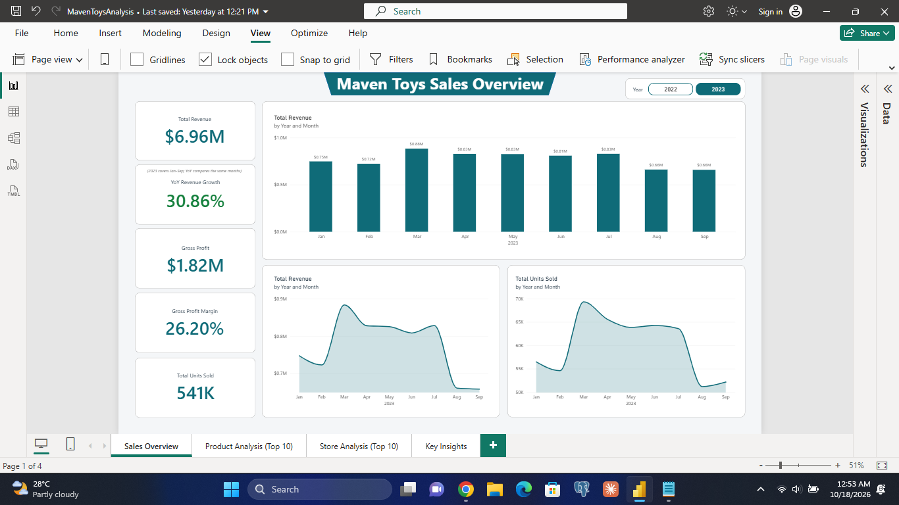
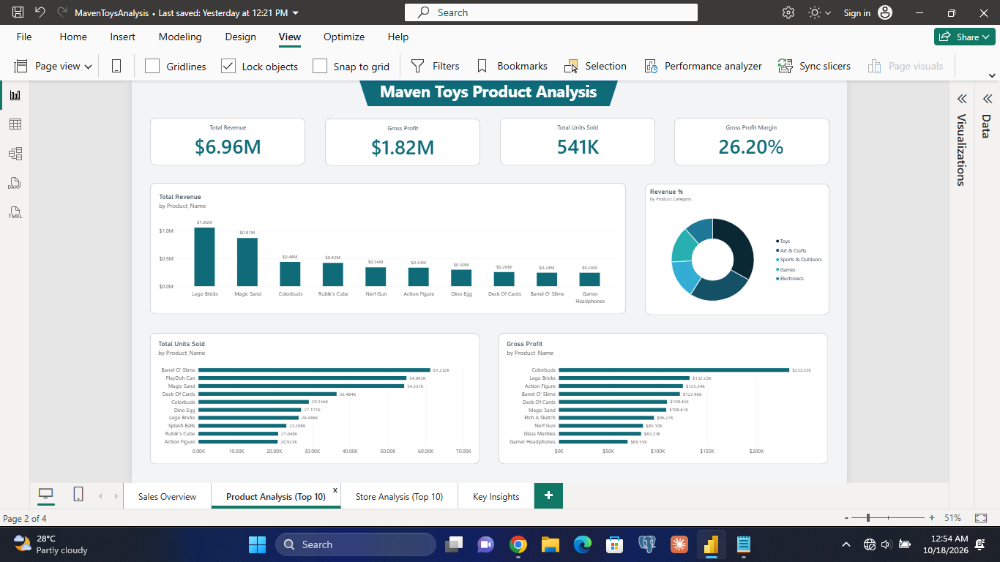
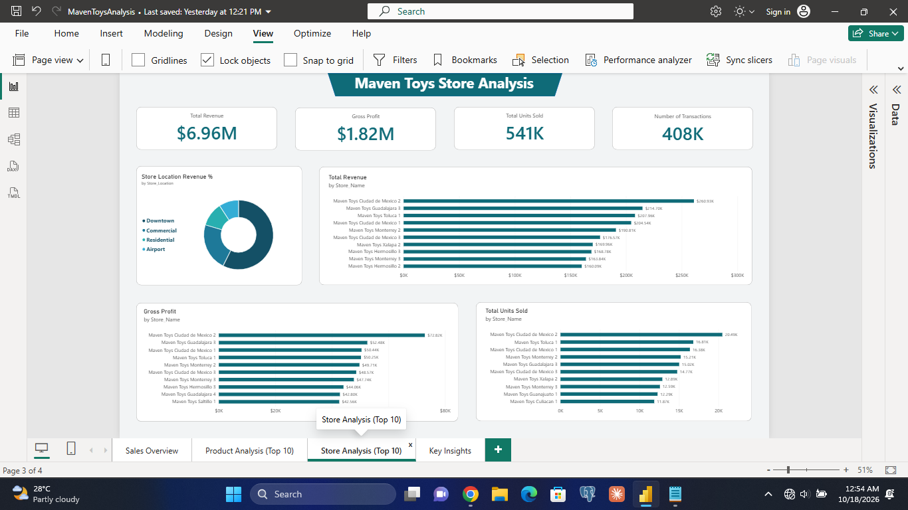

Maven Toys Sales Performance Analysis

An interactive Power BI project analyzing sales trends, product performance, store performance, and profitability using Maven Toys retail sales data.

Dashboard Preview

Sales Overview

Product Analysis

Store Analysis

Dashboard pages:
- Sales Overview
- Product Analysis
- Store Analysis

 1. Project Overview

This project analyzes Maven Toys' retail sales data using Power BI to evaluate business performance across products, stores, and time periods.

The goal is to transform raw sales data into an interactive dashboard that helps users monitor key performance indicators (KPIs), identify top-performing products and stores, and investigate the relationship between revenue and profitability.

 2. Business Objectives

- Evaluate overall sales performance using key performance indicators.
- Analyze revenue trends and year-over-year growth.
- Identify top-performing products and stores by revenue, units sold, and gross profit.
- Compare sales performance with gross profit margins.
- Develop data-driven insights and identify opportunities for further investigation.

 3. Tools and Technologies

| Tool |                   | Purpose |
Power BI Desktop           Dashboard development and data visualization 
Power Query                Data cleaning and transformation 
DAX                        Measures, KPI calculations, and time intelligence 
CSV                        Source data format 

 4. Dataset

Source: Maven Analytics — Maven Toys retail sales dataset  
Coverage: 2022–2023

The project uses sales transaction records alongside product and store information.

The main tables used in the data model are:

- fTransaction: Sales transaction records and units sold.
- dProducts: Product attributes, categories, selling prices, and costs.
- dStores: Store attributes and location information.
- dCalendar: A date table created for time-based analysis.

Dataset source link: (https://mavenanalytics.io/data-playground/mexico-toy-sales?utm_source=chatgpt.com)

 5. Data Preparation and Modeling

The data preparation process included:

1. Importing the source CSV files into Power BI.
2. Cleaning and transforming the data in Power Query.
3. Reviewing missing identifiers, null values, negative quantities and prices, duplicate records, and data types.
4. Reviewing cancelled transactions and applying the relevant cleaning rules.
5. Creating a calendar table with date attributes for time-based analysis.
6. Establishing relationships between the transaction table and the product, store, and calendar tables.
7. Validating transaction identifiers and preparing the data model for analysis.

The resulting model supports analysis across products, stores, and dates.

 6. Key Performance Indicators

The dashboard uses DAX measures to calculate the following metrics:

- Total Revenue: Total sales value calculated from units sold and product selling prices.
- Total Units Sold: Total quantity of products sold.
- Number of Transactions: Count of transaction records.
- Average Transaction Value: Total revenue divided by the number of transactions.
- Gross Profit: Revenue less the cost of goods sold, calculated using product costs and units sold.
- Gross Profit Margin: Gross profit expressed as a percentage of revenue.
- Revenue Last Year: Revenue for the corresponding period in the previous year.
- Year-over-Year Revenue Growth: Percentage change in revenue compared with the corresponding period in the previous year.

 7. Dashboard Analysis

 Page 1 — Sales Overview

Provides a high-level view of overall sales performance through KPI cards and time-based visuals.

The page helps users monitor revenue, units sold, transaction activity, average transaction value, and revenue trends.

 Page 2 — Product Performance

Examines product performance by revenue, units sold, and gross profit.

The analysis compares top-performing products and uses gross profit margins to assess whether products generating high sales also demonstrate strong profitability.

 Page 3 — Store Performance

Evaluates store performance using revenue, units sold, and gross profit.

The page compares leading stores and explores the relationship between sales contribution and profitability across store locations.

 8. Key Business Insights

 8.1 Revenue Growth and Profitability

Finding: Revenue increased by 30.86% when comparing January–September 2023 with the corresponding period in 2022. However, gross profit margin declined from 29.55% to 26.20%, a decrease of 3.35 percentage points.

Interpretation: Revenue growth did not coincide with an improvement in gross profit margin. Although sales increased, the business retained a smaller proportion of revenue as gross profit during the 2023 comparison period.

Next Question: Which products or product categories contributed most to the decline in gross profit margin despite revenue growth?

 8.2 Product Revenue vs. Profitability

Finding: Seven of the top 10 products ranked by gross profit have gross profit margins above the overall benchmark of 27.79%, compared with three of the top 10 products ranked by revenue.

Interpretation: Ranking products by revenue alone may not identify products with stronger profit margins. Evaluating revenue alongside profitability provides a more complete view of product performance.

Next Question: Which high-revenue products have below-benchmark gross profit margins, and what factors might explain their lower margins?

 8.3 Store Revenue vs. Gross Profit

Finding: Nine of the top 10 stores ranked by revenue also appear among the top 10 stores ranked by gross profit. Additionally, all 10 top-revenue stores have gross profit margins of at least 25%.

Interpretation: The overlap suggests that the highest-revenue stores also tend to be major contributors to gross profit. Considering both gross profit and gross profit margin helps distinguish sales contribution from profitability.

Next Question: Which products contribute most to revenue and gross profit within these stores, and do their product mixes help explain the stores' performance?

 9. Limitations and Further Analysis

This project focuses on sales performance and gross profitability using the available dataset.

The findings identify patterns and relationships in the data but do not independently establish the causes of changes in revenue or profitability.

The analysis does not establish net profit because operating expenses and other business costs are not included in the gross profit calculations.

Potential follow-up analyses include:

- Investigating product-level contributions to store performance.
- Examining products with high revenue but below-benchmark gross profit margins.
- Investigating product categories associated with changes in gross profit margin.
- Exploring additional operational or cost data to better understand profitability.

 10. Conclusion

This project demonstrates the use of Power BI, Power Query, and DAX to transform raw retail sales data into an interactive business intelligence dashboard.

Through data preparation, data modeling, KPI development, and business analysis, the project examines sales trends, product performance, store performance, and profitability.

The findings highlight why revenue should not be evaluated in isolation and demonstrate how dashboard analysis can lead to further business questions and investigations.
